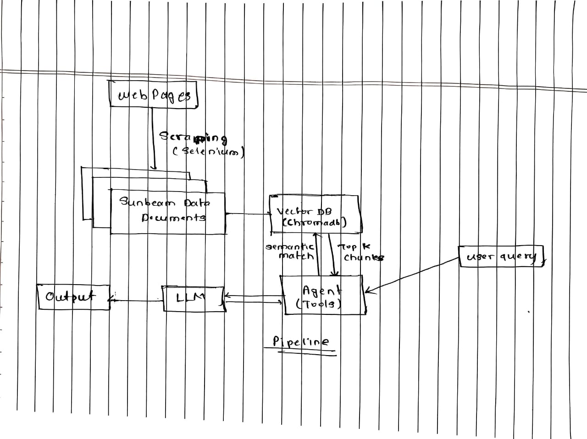

# Sunbeam AI Assistant: Agentic RAG Chatbot

An AI chatbot that answers questions about **Sunbeam Institute, Pune** (its courses, internships and the institute itself) using only data collected from the official Sunbeam website.

It is built as an **agentic RAG** system: a LangChain agent decides when to call a retrieval tool, the tool searches a ChromaDB vector database, and a Groq-hosted LLM writes the final answer strictly from the retrieved data.

**Live demo:** https://sunbeamchatbotteampb.streamlit.app/

Built by **Kanal Pawadi Piragond** during the Generative AI internship at Sunbeam Institute, Pune (Dec 2025).

---

## Features

- **Answers from real data only.** A strict system prompt makes the model use only retrieved Sunbeam data. Off-topic questions get *"Please ask a question related to Sunbeam"*, and missing data gets *"No data found"*.
- **Agentic tool calling.** The LLM itself decides to call the `get_sunbeam_data` tool, built with LangChain's `create_agent`.
- **Automated data collection.** Selenium scrapers collect course pages, internship details and the About Us page, including content hidden inside dropdowns.
- **Semantic search.** Text is split into chunks, converted to embeddings and stored in ChromaDB with metadata (source and title).
- **Fast responses.** LLM inference runs on Groq's API.
- **Chat UI.** A Streamlit app with login, multiple chat sessions, chat history and quick-question buttons (About Sunbeam, Core Java course, Internships).

---

## Architecture



```
            DATA PIPELINE (offline)
Sunbeam website
     |  Selenium (headless Chrome)
     v
Raw text files (.txt per course / internship / about page)
     |  RecursiveCharacterTextSplitter (600 chars, 100 overlap)
     v
Chunks + metadata (source, title)
     |  Embedding model
     v
ChromaDB  (collection: "Sunbeam_Data")


            QUESTION ANSWERING (online)
User question (Streamlit chat)
     |
     v
LangChain agent (LLM on Groq) --- calls tool ---> get_sunbeam_data(query)
     ^                                                   |
     |                                  embed query, top-5 similar chunks
     |                                                   |
     +------------------ JSON results -------------------+
     |
     v
Final answer, grounded only in the retrieved data
```

---

## Tech Stack

| Area | Tools |
|---|---|
| Language | Python 3.11 |
| LLM framework | LangChain (agents, tools, text splitters), LangGraph |
| LLM inference | Groq API (OpenAI-compatible endpoint), model `openai/gpt-oss-20b` |
| Embeddings | `nomic-embed-text-v1.5` (used during ingestion), `sentence-transformers/all-MiniLM-L6-v2` (used in the app) |
| Vector database | ChromaDB (persistent) |
| Data collection | Selenium (headless Chrome) |
| UI and deployment | Streamlit, Streamlit Cloud |

---

## Project Structure

```
.
├── UI_and_Agent/
│   └── sunbeam_chatbot.py        # Streamlit app + LangChain agent + retrieval tool
├── Data_Scrapping/
│   ├── main.py                   # Finds all course links and scrapes each course
│   ├── course.py                 # Selenium scraper for a single course page
│   ├── Internship_data.py        # Scrapes internship details
│   ├── data_scraping_about_us.py # Scrapes the About Us page
│   ├── store_data_to_chromadb.py # Chunks, embeds and stores everything in ChromaDB
│   ├── test_chroma.py            # Quick check of what is stored in the DB
│   ├── knowledge_base/           # Persistent ChromaDB database
│   └── *.txt                     # Scraped raw text, one file per course
├── project_data/                 # Earlier course-only RAG version (embed + agent)
├── Test/                         # Experiments: chunking, scraping prototypes
├── pipeline.jpeg                 # Architecture diagram
└── requirements.txt
```

---

## How It Works

1. **Scraping.** `Data_Scrapping/main.py` opens the Sunbeam modular courses page with headless Chrome, collects every course link and scrapes each course, opening dropdown sections so no details are missed. Internship and About Us data are scraped the same way.
2. **Chunking.** Text is split with `RecursiveCharacterTextSplitter` using a chunk size of 600 and an overlap of 100. Course text is split on blank lines, so each dropdown block (for example *Syllabus* or *Fees*) stays together.
3. **Embedding and storing.** Each chunk is embedded and saved to the `Sunbeam_Data` collection in ChromaDB, with metadata such as `source` and `title`. IDs are built from the chunk's title, so re-running the pipeline replaces old data instead of creating duplicates.
4. **Retrieval tool.** `get_sunbeam_data(user_query)` embeds the question, fetches the **top 5** most similar chunks and returns them as JSON.
5. **Agent.** A LangChain agent with a strict system prompt must call the tool for every Sunbeam question and answer only from what the tool returns. This keeps answers grounded and prevents hallucination.
6. **UI.** Streamlit shows a login page, a chat sidebar (New Chat, switch between chats, Logout), quick-question buttons and the chat window.

---

## Setup and Run Locally

### 1. Clone and install

```bash
git clone https://github.com/kanalpawadi/IIT-08-H-A_GENERATIVE-AI-94455-MAIN_PROJECT.git
cd IIT-08-H-A_GENERATIVE-AI-94455-MAIN_PROJECT

python -m venv venv
venv\Scripts\activate          # Windows
# source venv/bin/activate     # macOS / Linux

pip install -r requirements.txt
pip install selenium langchain-text-splitters
```

### 2. Add your Groq API key

Create a `.env` file in the project root:

```
GROQ_API_KEY=your_groq_api_key_here
```

You can get a free key at https://console.groq.com.

### 3. (Optional) Rebuild the knowledge base

A ready-made database is already included in `Data_Scrapping/knowledge_base/`. To scrape fresh data and rebuild it (needs Google Chrome installed):

```bash
cd Data_Scrapping
python store_data_to_chromadb.py
```

> The ingestion scripts create embeddings through a local OpenAI-compatible server (for example LM Studio at `http://127.0.0.1:1234/v1`) running `nomic-embed-text-v1.5`. The app must query with the **same embedding model** that was used to build the database.

### 4. Run the chatbot

```bash
streamlit run UI_and_Agent/sunbeam_chatbot.py
```

Before running, make sure the ChromaDB path in `sunbeam_chatbot.py` points to your `Data_Scrapping/knowledge_base` folder.

---

## Example Questions

- *Give me full information about Sunbeam Infotech Institute*
- *What is the duration and fee of the Core Java course?*
- *Which internship programs does Sunbeam offer?*
- *What topics are covered in the Mastering Generative AI course?*
- *What is the weather today?* (out of scope, so the bot replies "Please ask a question related to Sunbeam")

---

## Future Improvements

- Use one embedding model for both ingestion and querying, and load it from config
- Move login credentials and file paths into environment variables / Streamlit secrets
- Add conversation memory so follow-up questions use earlier context
- Show the source of each answer (course page or section)
- Schedule automatic re-scraping so course details stay up to date
- Evaluate retrieval and answers with a fixed question set (e.g. RAGAS)
